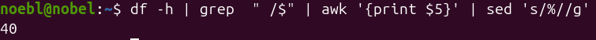
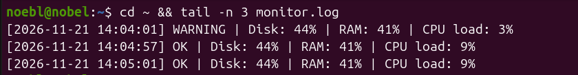
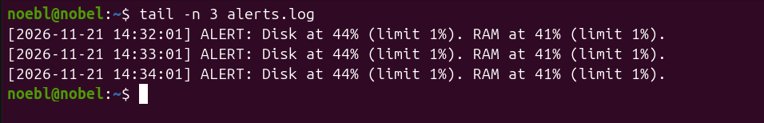

# Linux System Health Monitor

A Bash script that checks disk, RAM and CPU load on a Linux machine, logs every check with a timestamp, raises an alert when a limit is crossed, and runs automatically every minute with cron.

## Features
- Monitors root disk usage, RAM usage and CPU load
- Configurable thresholds (default 80% for each)
- One timestamped log line per check
- Alerts name the exact metric, its value and the limit
- Alerts go to a separate alert file and to the system log
- Runs automatically through cron

## Tech Used
Bash · Ubuntu · cron · df, free, uptime, nproc · grep, awk, sed · logger, journalctl

## How the Numbers Are Collected

### Disk usage
```bash
df -h | grep " /$"
```


```bash
df -h | grep " /$" | awk '{print $5}'
```


```bash
df -h | grep " /$" | awk '{print $5}' | sed 's/%//g'
```


### RAM usage
Percentage of total memory that is not available:
```bash
free -m | awk '/Mem:/ {printf "%d", ($2-$7)/$2*100}'
```

### CPU load
The 1-minute load average divided by the number of CPU cores, as a percentage (it can go above 100% on a heavily loaded machine):
```bash
uptime | awk -F'load average:' '{print $2}' | cut -d, -f1
nproc
```

## The Script

```bash
#!/bin/bash

LOG_FILE="/home/noebl/monitor.log"
ALERT_FILE="/home/noebl/alerts.log"
DISK_THRESHOLD=80
RAM_THRESHOLD=80
CPU_THRESHOLD=80

TIMESTAMP=$(date '+%Y-%m-%d %H:%M:%S')

# Disk: percentage used on /
DISK_USAGE=$(df -h | grep " /$" | awk '{print $5}' | sed 's/%//g')

# RAM: percentage used, based on the "available" column of free -m
RAM_USAGE=$(free -m | awk '/Mem:/ {printf "%d", ($2-$7)/$2*100}')

# CPU: 1-minute load average as a percentage of the number of cores
LOAD=$(uptime | awk -F'load average:' '{print $2}' | cut -d, -f1 | xargs)
CORES=$(nproc)
CPU_USAGE=$(awk -v l="$LOAD" -v c="$CORES" 'BEGIN {printf "%d", l/c*100}')

STATUS="OK"
ALERTS=""

if [ "$DISK_USAGE" -ge "$DISK_THRESHOLD" ]; then
    STATUS="WARNING"
    ALERTS="$ALERTS Disk at ${DISK_USAGE}% (limit ${DISK_THRESHOLD}%)."
fi

if [ "$RAM_USAGE" -ge "$RAM_THRESHOLD" ]; then
    STATUS="WARNING"
    ALERTS="$ALERTS RAM at ${RAM_USAGE}% (limit ${RAM_THRESHOLD}%)."
fi

if [ "$CPU_USAGE" -ge "$CPU_THRESHOLD" ]; then
    STATUS="WARNING"
    ALERTS="$ALERTS CPU load at ${CPU_USAGE}% (limit ${CPU_THRESHOLD}%)."
fi

echo "[$TIMESTAMP] $STATUS | Disk: ${DISK_USAGE}% | RAM: ${RAM_USAGE}% | CPU load: ${CPU_USAGE}%" >> "$LOG_FILE"

if [ "$STATUS" = "WARNING" ]; then
    echo "[$TIMESTAMP] ALERT:$ALERTS" >> "$ALERT_FILE"
    logger -p user.warning -t disk-monitor "ALERT:$ALERTS"
fi
```

## Configuration
Edit the variables at the top of `monitor.sh`:
- `LOG_FILE` and `ALERT_FILE`: use absolute paths (change `/home/noebl` to your own home folder)
- `DISK_THRESHOLD`, `RAM_THRESHOLD`, `CPU_THRESHOLD`: the percentage that triggers a warning

## Usage
```bash
chmod +x monitor.sh
./monitor.sh
tail -n 3 /home/noebl/monitor.log
```

## Automating with Cron
```bash
crontab -e
```
Add this line to run the script every minute:
```
* * * * * /home/noebl/Linux-Disk-Monitor/monitor.sh
```
Use an absolute path, because cron does not start in your project folder. Verify with `crontab -l`.

## Example Output

Log lines (the WARNING was forced by temporarily lowering a threshold to test the alert path):
```
[2026-11-21 14:04:01] WARNING | Disk: 44% | RAM: 41% | CPU load: 3%
[2026-11-21 14:04:57] OK | Disk: 44% | RAM: 41% | CPU load: 9%
[2026-11-21 14:05:01] OK | Disk: 44% | RAM: 41% | CPU load: 9%
```


Alert file and system log:
```
[2026-11-21 14:18:23] ALERT: Disk at 44% (limit 1%).
```


View system log alerts with:
```bash
journalctl -t disk-monitor
```

## What I Learned
- Chaining commands with pipes and capturing output in variables
- Conditional logic and multiple checks in Bash
- Scheduling with cron and why it needs absolute paths
- Writing to the system log with `logger`
- Testing a script by forcing its warning path, then verifying each number against the real tools

## Future Improvements
- Log rotation so `monitor.log` doesn't grow forever
- Email or chat notifications on alerts
- Move the thresholds into a separate config file
