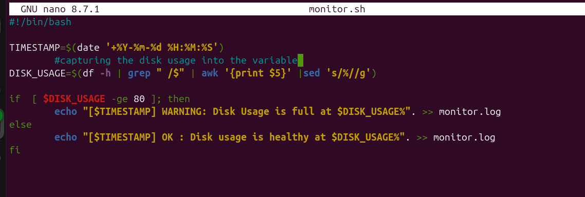
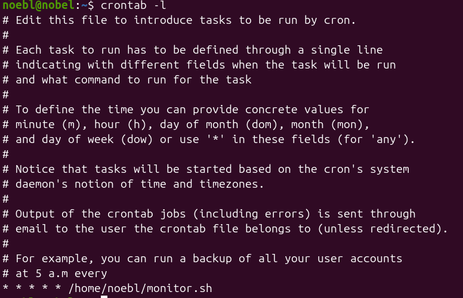
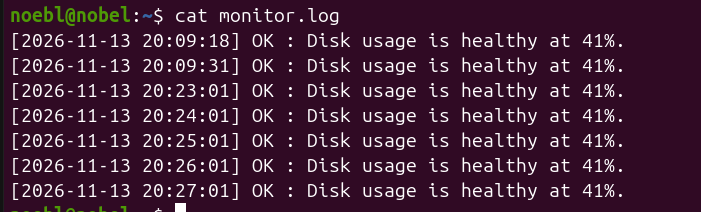
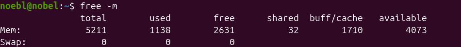

# Linux Disk Usage Monitor

A simple Bash script that checks root (`/`) disk usage, logs the result with a timestamp, and runs automatically every minute using cron.

## Features
- Reads disk usage of `/` using `df`, `grep`, `awk` and `sed`
- Prints a **WARNING** when usage is 80% or more, otherwise **OK**
- Adds a timestamp to every entry
- Appends results to `monitor.log`
- Runs automatically through a cron job

## Tech Used
Bash · Linux (Ubuntu) · cron · df / grep / awk / sed

## How It Works

### 1. Get the disk usage line
```bash
df -h | grep " /$"
```


### 2. Extract the usage column
```bash
df -h | grep " /$" | awk '{print $5}'
```


### 3. Remove the `%` sign
```bash
df -h | grep " /$" | awk '{print $5}' | sed 's/%//g'
```


## The Script

```bash
#!/bin/bash

TIMESTAMP=$(date '+%Y-%m-%d %H:%M:%S')

# Capture disk usage (number only) into a variable
DISK_USAGE=$(df -h | grep " /$" | awk '{print $5}' | sed 's/%//g')

if [ "$DISK_USAGE" -ge 80 ]; then
    echo "[$TIMESTAMP] WARNING: Disk usage is full at $DISK_USAGE%." >> monitor.log
else
    echo "[$TIMESTAMP] OK : Disk usage is healthy at $DISK_USAGE%." >> monitor.log
fi
```


## Usage

```bash
chmod +x monitor.sh
./monitor.sh
cat monitor.log
```


## Automating with Cron

```bash
crontab -e
```
Add this line to run the script every minute:
```
* * * * * /home/noebl/monitor.sh
```
Verify with:
```bash
crontab -l
```


## Result
The log fills up automatically, one entry per minute:



## Other Commands Explored
| Command | Purpose |
|---|---|
| `uptime` | System load average |
| `free -m` | RAM usage in MB |
| `pwd` | Find absolute path for cron |




## What I Learned
- Chaining commands with pipes
- Capturing command output in variables
- Conditional logic in Bash
- Redirecting output with `>>`
- Scheduling tasks with cron and why cron needs absolute paths

## Future Improvements
- Add CPU load and RAM checks to the script
- Send an email or alert on WARNING
- Use an absolute path for the log file
- Rotate old logs
